# Laboratorio de monitoreo de seguridad con Wazuh en Oracle Cloud

Monté un SIEM con **Wazuh 4.14** en **Oracle Cloud**: un servidor central y un equipo monitoreado con agente, como en una empresa real. Lo probé con tres escenarios: **fuerza bruta por SSH**, **modificación de archivos sensibles** y **gestión de vulnerabilidades**. Wazuh detectó todo y lo clasificó con **MITRE ATT&CK**. Además, registró un intento de acceso **real** desde internet, que confirmé en AbuseIPDB.

Para replicar el laboratorio paso a paso: [RUNBOOK.md](RUNBOOK.md).

## Qué demuestra este proyecto

| Área | Qué hice |
| --- | --- |
| Nube | Dos VMs en Oracle Cloud, red virtual (VCN), subred y reglas de acceso por puerto |
| Linux | Administración por SSH con llaves, `iptables`, `systemd`, `apt`, lectura y búsqueda en logs |
| Seguridad | SIEM, detección de fuerza bruta, monitoreo de integridad (FIM), gestión de vulnerabilidades, MITRE ATT&CK |
| Investigación | Verificación de una IP atacante con inteligencia de amenazas y de CVE en el tracker oficial de Ubuntu |
| Troubleshooting | Diagnóstico de servicios, configuración y del escáner consultando la API del indexer |

## Arquitectura

```
                     [ Internet ]
                          │  22, 443, 1514, 1515
                          ▼
┌─────────────── Oracle Cloud · VCN 10.0.0.0/16 ───────────────┐
│                                                               │
│  [ wazuh-server ]  ◄── eventos (1514/1515, red privada) ──  [ endpoint-ubuntu ]
│   Ubuntu 22.04 · 2 OCPU · 8 GB                               Ubuntu 22.04 · 1 OCPU · 2 GB
│   ├── wazuh-manager   (análisis y reglas)                    └── wazuh-agent
│   ├── wazuh-indexer   (almacenamiento)                           (equipo de "empleado")
│   ├── wazuh-dashboard (interfaz web, 443)                    │
│   └── filebeat        (envío de alertas)                     │
└───────────────────────────────────────────────────────────────┘
```

El agente se conecta al servidor por la **IP privada**, así que el tráfico de monitoreo no sale a internet.

### Reglas de acceso (Security List)

| Puerto | Origen permitido | Por qué |
| --- | --- | --- |
| 22 (SSH) | Internet | Solo acepta llave SSH; mi IP cambia entre redes |
| 443 (dashboard) | Solo mi IP (`/32`) | El login del SIEM no queda expuesto a internet |
| 1514-1515 (agentes) | Solo la subred privada `10.0.0.0/24` | Nadie de afuera puede registrar agentes falsos ni enviar eventos |

Al principio estos puertos estaban abiertos a todo internet. Los restringí después de una revisión: el puerto 1515 abierto permitía que cualquiera registrara un agente, porque Wazuh no pide contraseña por defecto.

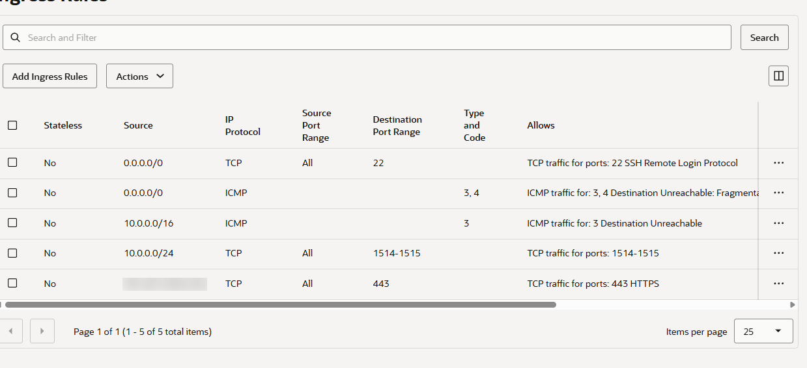

## Instalación (resumen)

Detalle completo en el [RUNBOOK](RUNBOOK.md).

```bash
# Puertos en el firewall interno (además de la Security List de Oracle)
sudo iptables -I INPUT -p tcp -m multiport --dports 443,1514,1515 -j ACCEPT
sudo netfilter-persistent save

# Wazuh todo en uno
curl -sO https://packages.wazuh.com/4.14/wazuh-install.sh
sudo bash ./wazuh-install.sh -a

# Verificación
for s in wazuh-manager wazuh-indexer wazuh-dashboard filebeat; do echo "$s: $(systemctl is-active $s)"; done
```

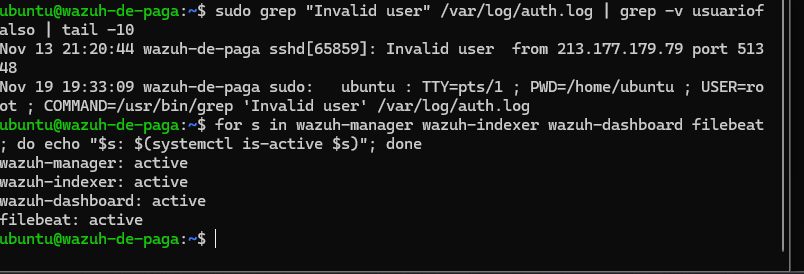

## Prueba 1: ataque de fuerza bruta por SSH

**Simulación:** 10 intentos de acceso seguidos con un usuario inexistente, como hacen los bots.

```powershell
1..10 | ForEach-Object { ssh -o BatchMode=yes -o StrictHostKeyChecking=no usuariofalso@<IP_DEL_SERVIDOR> exit }
```

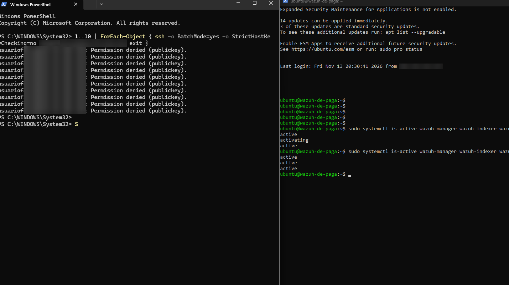

**Resultado:** cada intento disparó la regla **5710**, y la secuencia completa disparó la **5712 (nivel 10)**, *"sshd: brute force trying to get access to the system"*. Wazuh la clasificó en MITRE ATT&CK como **Brute Force**, **Password Guessing** y **SSH**.

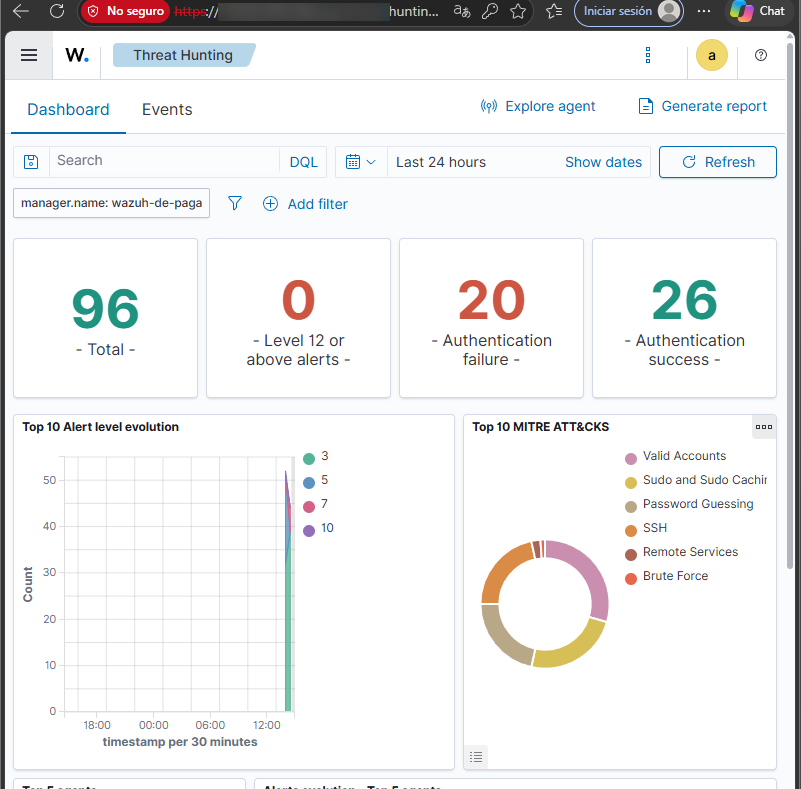
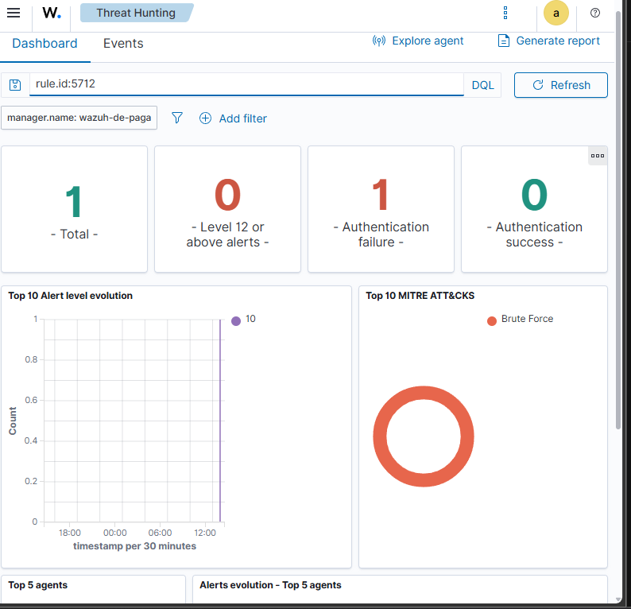
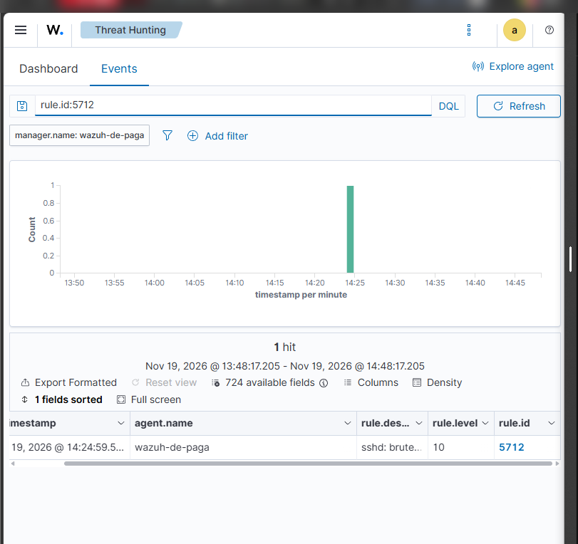

El ataque no podía tener éxito: el servidor solo acepta autenticación con llave SSH.

### Un ataque real, verificado

En `/var/log/auth.log` apareció un intento de acceso que no hice yo, el mismo día en que publiqué el servidor:

```bash
sudo grep "Invalid user" /var/log/auth.log | grep -v usuariofalso
```

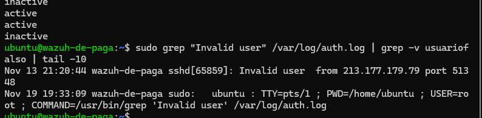

Verifiqué la IP `213.177.179.79` en **AbuseIPDB**: **100 % de confianza de abuso**, más de **11.000 reportes** de 1.200 administradores distintos, alojada en un datacenter de Países Bajos. Es un escáner automático que recorre internet buscando servidores SSH.

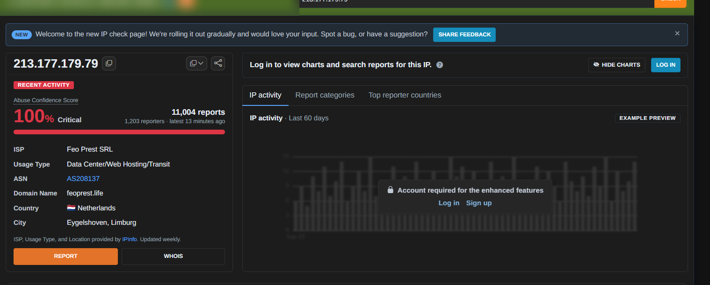

## Prueba 2: monitoreo de integridad de archivos (FIM)

**Objetivo:** detectar en tiempo real si alguien crea, modifica o borra archivos sensibles, y ver qué cambió.

**Configuración**, como en producción: copia de seguridad, edición y verificación en el log.

```bash
sudo cp /var/ossec/etc/ossec.conf /var/ossec/etc/ossec.conf.bak
sudo nano /var/ossec/etc/ossec.conf
```

Dentro de `<syscheck>`:

```xml
<directories realtime="yes" report_changes="yes" check_all="yes">/home/ubuntu/confidencial</directories>
```

```bash
sudo systemctl restart wazuh-manager
sudo grep -i "confidencial" /var/ossec/logs/ossec.log | tail -3
```

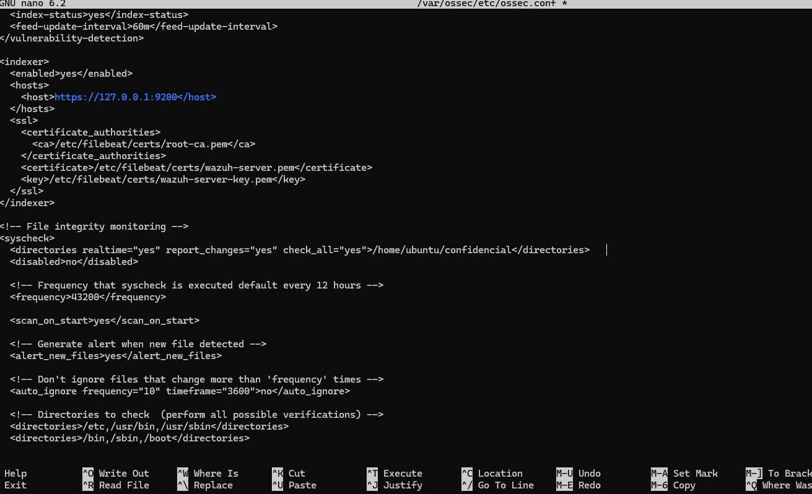
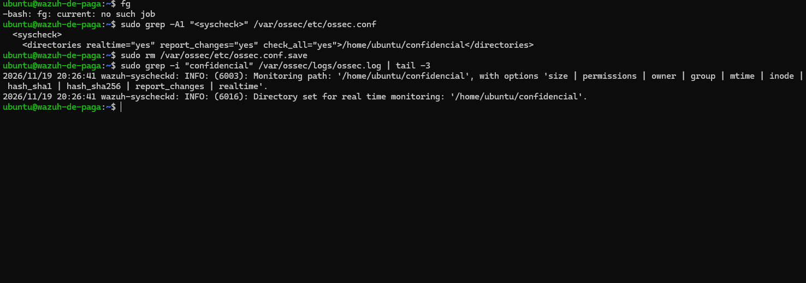

**Simulación:** crear un archivo con una credencial falsa, modificarla y borrar el archivo.

```bash
echo "password_db=Secreto123" > ~/confidencial/config.txt
echo "password_db=Hackeado999" > ~/confidencial/config.txt
rm ~/confidencial/config.txt
```

**Resultado:** tres alertas (archivo creado, modificado y borrado), clasificadas como **Stored Data Manipulation**, **File Deletion** y **Data Destruction**.

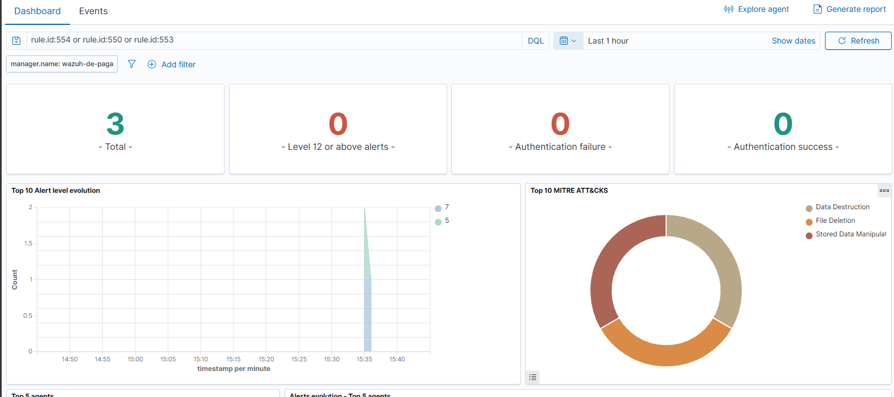
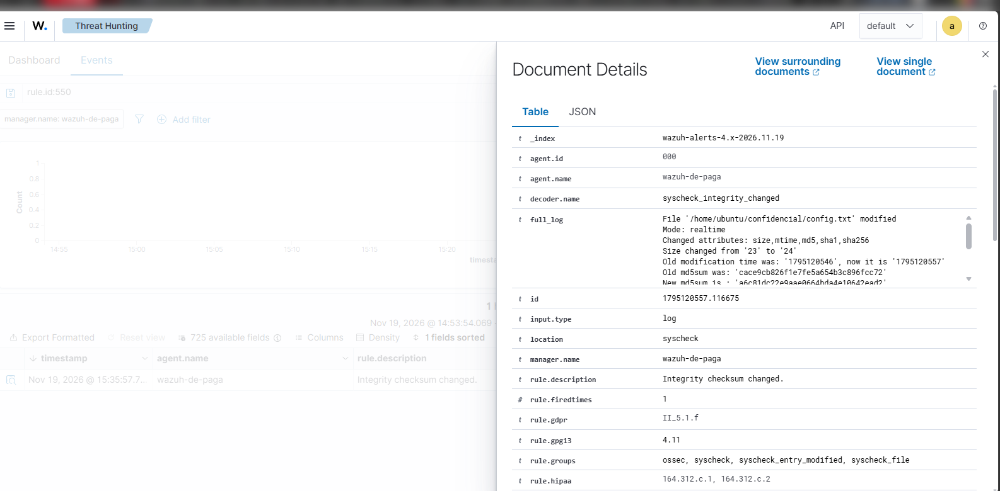

Gracias a `report_changes`, la alerta muestra **exactamente qué cambió**:

```
< password_db=Secreto123
---
> password_db=Hackeado999
```

La alerta queda mapeada a **MITRE T1565.001** (táctica *Impact*), **PCI DSS 11.5** y **NIST 800-53 SI.7**, los controles que exigen monitorear la integridad de archivos.

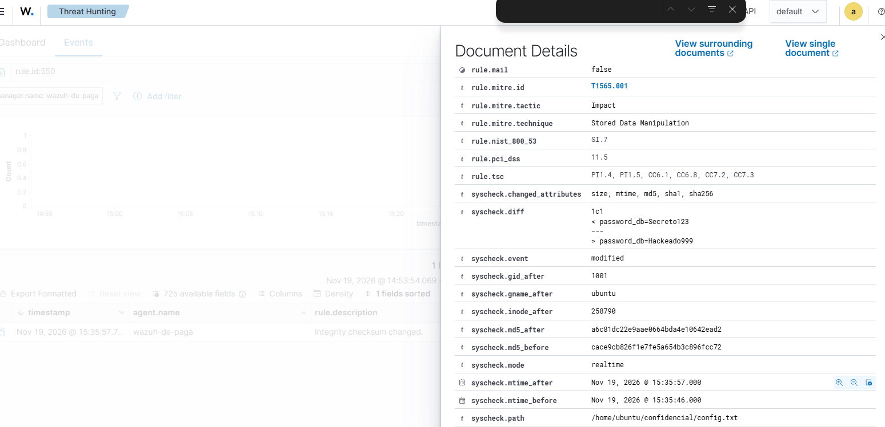

## Prueba 3: gestión de vulnerabilidades

**Detección.** Con el agente instalado en `endpoint-ubuntu`, Wazuh inventarió sus paquetes y los cruzó con su base de CVE:

| Gravedad | Antes de actualizar | Después | Resueltas |
| --- | --- | --- | --- |
| Critical | 17 | 17 | 0 |
| High | 613 | 602 | 11 |
| Medium | 1.208 | 1.199 | 9 |
| Low | 217 | 211 | 6 |
| **Total** | **2.539** | **2.513** | **26** |

Casi todo (2.502) estaba en un solo paquete: el kernel `linux-oracle`.

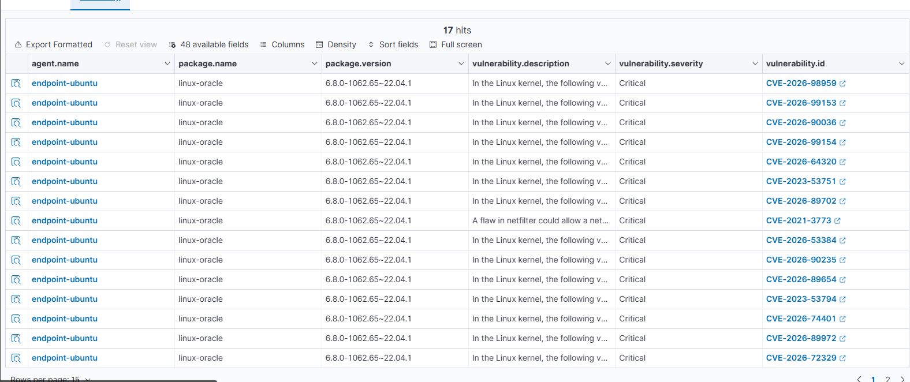

**Remediación.** Actualicé el sistema y reinicié para cargar el kernel nuevo (`6.8.0-1062` → `6.8.0-1068`):

```bash
sudo apt update && sudo apt upgrade -y
sudo reboot
uname -r
sudo apt autoremove -y
```

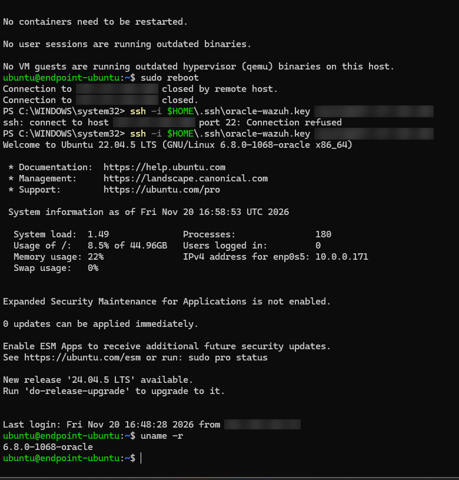

**Verificación.** Wazuh reevaluó el kernel nuevo y marcó 26 vulnerabilidades como resueltas, pero las 17 críticas siguieron. En vez de asumir que no tenían parche, verifiqué 5 en el **tracker oficial de Ubuntu**, en la fila del paquete que realmente provee el kernel instalado:

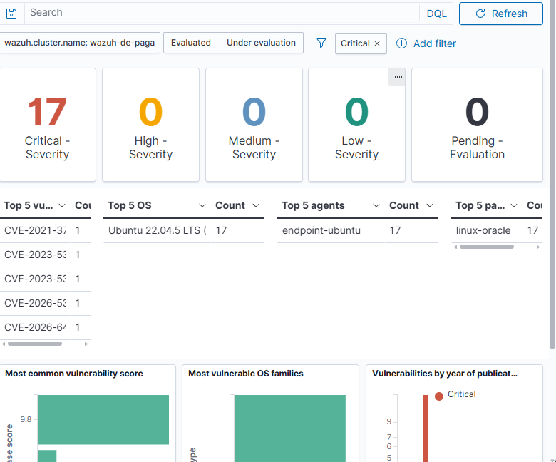

| CVE | `linux-oracle-6.8` en 22.04 | Kernel instalado `6.8.0-1068.72` | Resultado |
| --- | --- | --- | --- |
| CVE-2026-98959 | Fixed en `6.8.0-1067.71` | Ya parchado | Falso positivo |
| CVE-2026-64320 | Fixed en `6.8.0-1067.71` | Ya parchado | Falso positivo |
| CVE-2026-99153 / CVE-2026-90036 | Fixed en `6.8.0-1067.71` | Ya parchado | Falso positivo |
| CVE-2026-99153 / CVE-2026-90036 | Fixed en `6.8.0-1068.72` | Parchado por esta actualización | Falso positivo |
| CVE-2021-3773 | Ignored, *no upstream fix* | Sin parche disponible | Real |

**Causa raíz:** en Ubuntu 22.04, el kernel 6.8 viene del paquete `linux-oracle-6.8`. El tracker indica que el paquete `linux-oracle` fue **reemplazado** (*"superseded by linux-oracle-6.8"*), pero el escáner sigue evaluando el kernel contra `linux-oracle` y por eso marca como vulnerables fallas que ya están corregidas.

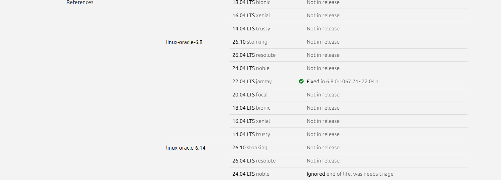
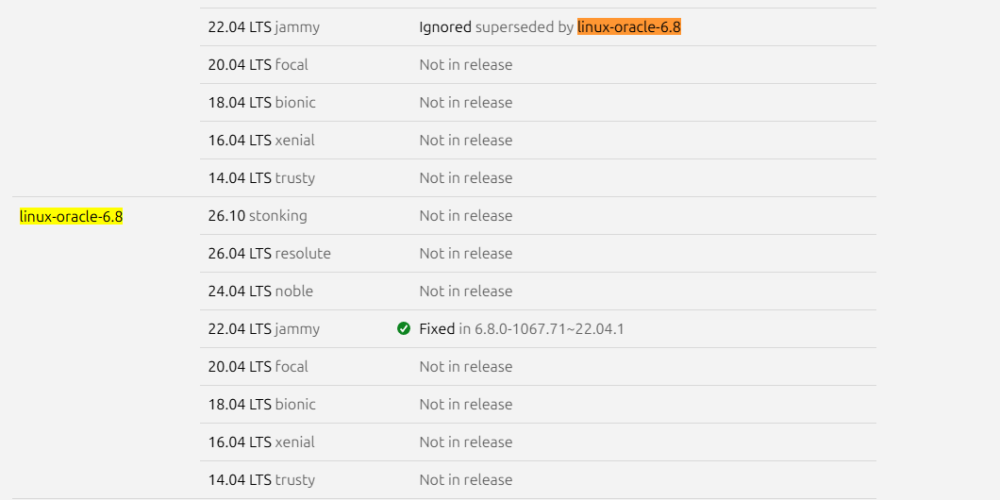

**Resultado:** de las 5 críticas verificadas, 4 eran falsos positivos (una de ellas la corrigió justamente la actualización) y solo 1 es real. Las 12 restantes quedan por verificar con el mismo método.

**Tratamiento de la vulnerabilidad real** (CVE-2021-3773, sin parche del fabricante): se documenta como **riesgo aceptado** con controles compensatorios (acceso solo por llave SSH, puertos mínimos y monitoreo con Wazuh) y se revisa cuando exista una corrección.

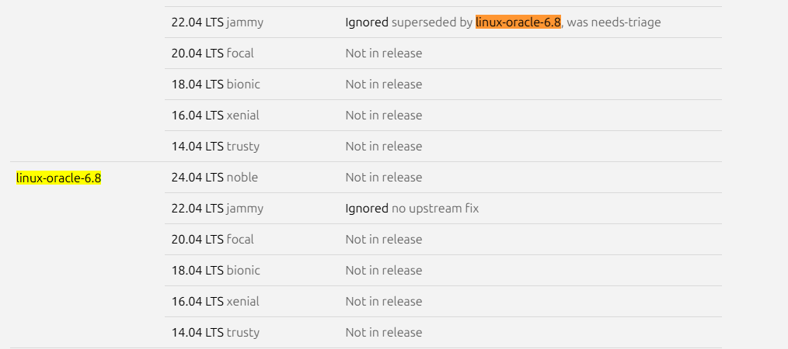

**Lección:** un escáner no se cree a ciegas, y una sola muestra no alcanza para concluir. Mi primera verificación miró la fila equivocada del tracker y me llevó a pensar que ninguna tenía parche; al revisar 5 en el paquete correcto, la conclusión cambió.

## Problemas que resolví

| Problema | Causa | Solución |
| --- | --- | --- |
| "Out of host capacity" al crear la VM | No había capacidad ARM en la región Bogotá | Usé la shape AMD E5.Flex |
| No se podía asignar IP pública | Conflicto al crear una VCN nueva | Reutilicé una VCN con subred pública |
| Dashboard inaccesible con el puerto abierto en Oracle | Ubuntu en Oracle trae su propio firewall `iptables` | Abrí los puertos también en `iptables` y los hice persistentes |
| Contraseña de admin rechazada | Política de contraseñas del indexer | Regeneré la contraseña con `wazuh-passwords-tool.sh` |
| Línea duplicada al editar `ossec.conf` | Pegado doble en `nano` | Corregí la línea y verifiqué en el log; tenía copia de seguridad |
| Críticas del kernel que seguían después de parchear | El escáner compara el kernel contra `linux-oracle`, reemplazado en 22.04 por `linux-oracle-6.8` | Verifiqué cada CVE en la fila correcta del tracker de Ubuntu: 4 de 5 eran falsos positivos |
| Tablero de vulnerabilidades vacío | El escáner evalúa los paquetes que reportan los agentes, y aún no había un agente conectado | Lo diagnostiqué con la API del indexer (`_cat/indices`) y conecté un endpoint con agente |

```bash
# Diagnóstico del escáner con la API del indexer
curl -k -u admin "https://127.0.0.1:9200/_cat/indices/wazuh-states-vuln*?v"
curl -k -u admin "https://127.0.0.1:9200/_cat/indices/wazuh-states-inventory*?v"
```

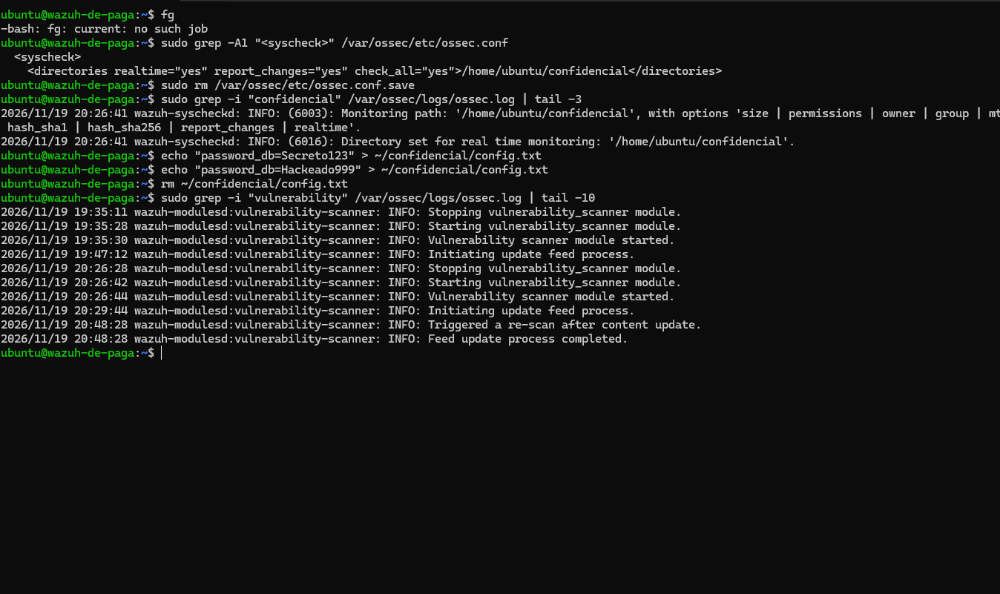

## Buenas prácticas aplicadas

- Acceso SSH solo con llave; la llave privada nunca sale del equipo.
- Agente conectado por red privada; puertos de agentes y dashboard restringidos por origen.
- Copia de seguridad antes de cambiar cualquier configuración, y verificación en logs después.
- Hallazgos verificados en fuentes oficiales antes de reportarlos.
- Contraseñas e IPs tapadas en todas las capturas publicadas.
- VMs apagadas al terminar cada sesión.

## Próximos pasos

- Restringir también SSH (22) con el servicio Bastion de Oracle.
- Verificar las 12 vulnerabilidades críticas restantes.
- Definir la red y las VMs con Terraform (infraestructura como código).
- Respuesta activa: bloquear automáticamente las IPs que hagan fuerza bruta.
- Monitorear contenedores Docker con Wazuh.
